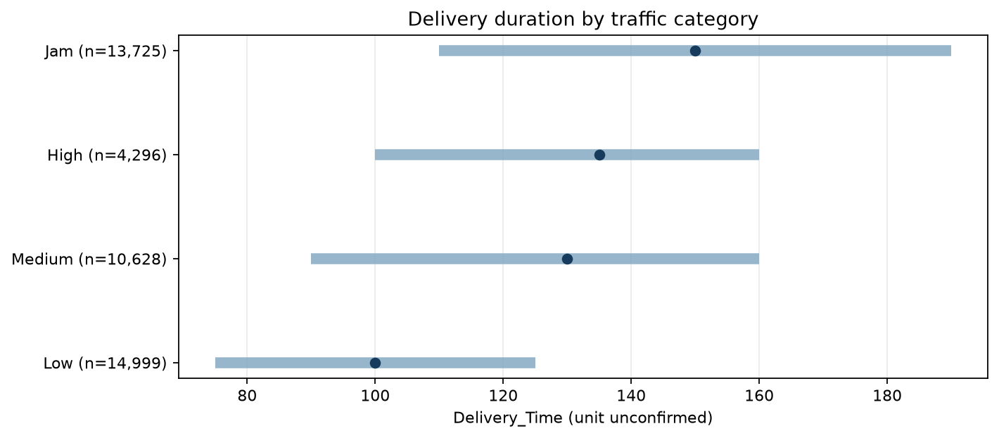
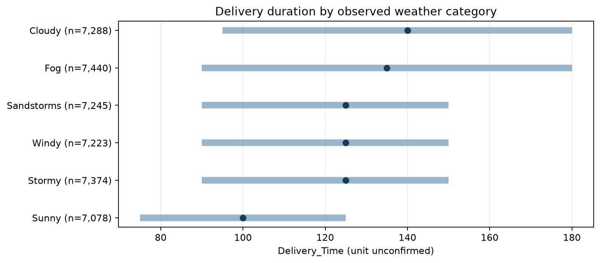
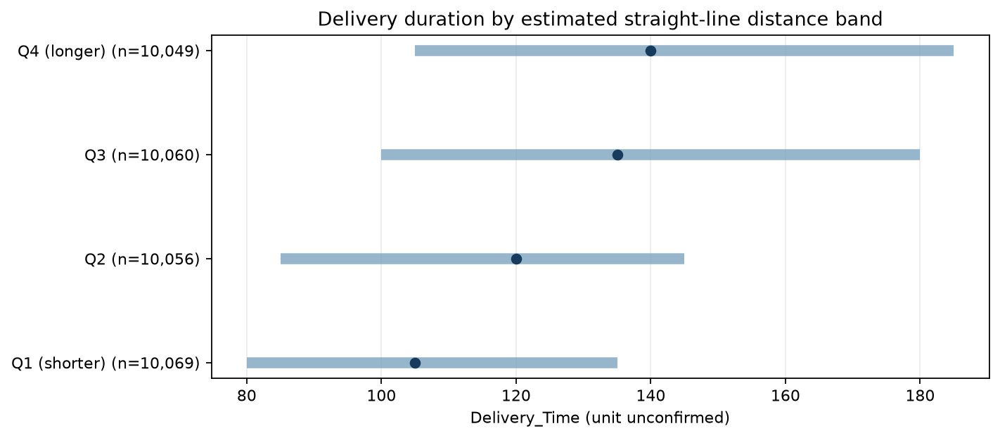
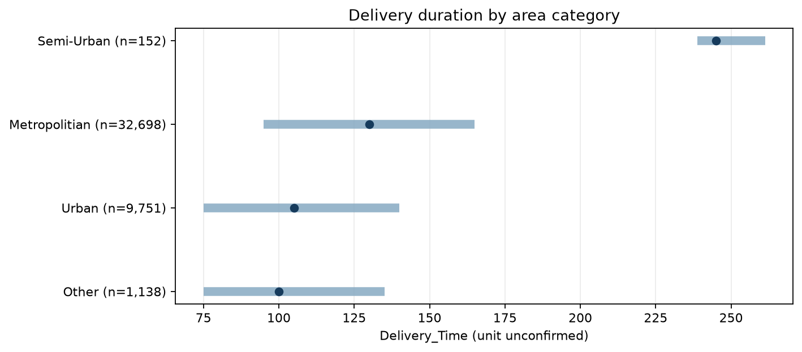
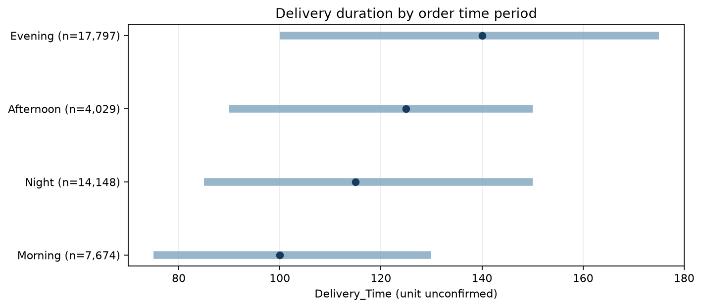
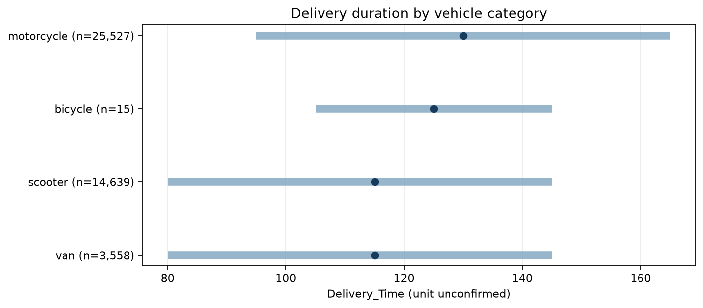

# Delivery duration across key factors

## Dataset and method

This analysis uses the approved `amazon_delivery_cleaned_updated.csv` in the user’s Downloads folder. The file contains 43,739 records and 28 columns. The CSV remains outside the project repository.

`Delivery_Time` is analyzed as delivery duration, with its unit unspecified because it has not been verified. `Pickup_Delay_Minutes` is an order-to-pickup duration in minutes. It is not used as a delivery-delay or promise-based measure. No on-time, late, completion, or promise-based delay rates are calculated; the dataset has no promised delivery time, actual delivery timestamp, or delivery status.

Each group table reports nonmissing group sample size, mean, median, 90th percentile, minimum, and maximum of `Delivery_Time`. Group results are descriptive; differences do not establish causes.

## Key observations

- Median delivery duration ranges from 100 in the Low traffic group (`n=14,999`) to 150 in the Jam group (`n=13,725`); the High traffic group median is 135 (`n=4,296`), so the pattern is not a simple ordered increase across all traffic labels.
- Weather group medians range from 100 for Sunny to 140 for Cloudy, with 7,078 and 7,288 records respectively.
- Across estimated straight-line distance quartile bands, median delivery duration increases from 105 in the shorter-distance quartile to 140 in the longer-distance quartile.
- Evening orders have a median of 140 (`n=17,797`) compared with 100 for Morning orders (`n=7,674`).
- The Semi-Urban group has a median of 245 (`n=152`), much higher than the other Area medians; its smaller count warrants caution. Grocery has a median of 26, while other product category medians range from 125 to 130.

These are unadjusted descriptive comparisons. Category relationships may overlap, and none of these differences establishes a cause.

## Traffic

| Traffic | records | mean | median | p90 | minimum | maximum |
| --- | --- | --- | --- | --- | --- | --- |
| Low | 14,999 | 101.35 | 100.00 | 145.00 | 10 | 220 |
| Medium | 10,628 | 126.84 | 130.00 | 190.00 | 10 | 245 |
| High | 4,296 | 129.42 | 135.00 | 185.00 | 10 | 270 |
| Jam | 13,725 | 147.76 | 150.00 | 220.00 | 10 | 270 |

## Weather

| Weather | records | mean | median | p90 | minimum | maximum |
| --- | --- | --- | --- | --- | --- | --- |
| Sunny | 7,078 | 103.66 | 100.00 | 160.00 | 10 | 270 |
| Stormy | 7,374 | 123.21 | 125.00 | 185.00 | 10 | 270 |
| Windy | 7,223 | 123.66 | 125.00 | 185.00 | 10 | 270 |
| Sandstorms | 7,245 | 123.24 | 125.00 | 185.00 | 10 | 270 |
| Fog | 7,440 | 136.57 | 135.00 | 210.00 | 10 | 270 |
| Cloudy | 7,288 | 138.29 | 140.00 | 210.00 | 10 | 270 |

## Estimated straight-line distance

A great-circle distance was computed from valid store and drop coordinates for 40,234 of 43,739 records. This is a straight-line estimate in kilometers, not road distance or route length. Missing or invalid coordinate pairs were excluded. Quartile bands are based on the usable distance sample. A coordinate sanity check found 188 estimates above 50 km, with a maximum of 19,692.70 km; these extreme values were retained because no approved exclusion rule exists, and the upper distance group should be interpreted cautiously.

Estimated straight-line distance summary (km):

| index | value |
| --- | --- |
| count | 40,234.00 |
| mean | 41.06 |
| std | 557.29 |
| min | 1.47 |
| 25% | 4.66 |
| 50% | 9.22 |
| 75% | 13.68 |
| 90% | 19.36 |
| max | 19,692.70 |

| Distance_Band | records | mean | median | p90 | minimum | maximum |
| --- | --- | --- | --- | --- | --- | --- |
| Q1 (shorter) | 10,069 | 105.09 | 105.00 | 155.00 | 10 | 270 |
| Q2 | 10,056 | 115.84 | 120.00 | 170.00 | 10 | 270 |
| Q3 | 10,060 | 137.33 | 135.00 | 210.00 | 10 | 270 |
| Q4 (longer) | 10,049 | 142.02 | 140.00 | 215.00 | 10 | 270 |

## Other available categories

### Area

| Area | records | mean | median | p90 | minimum | maximum |
| --- | --- | --- | --- | --- | --- | --- |
| Other | 1,138 | 104.46 | 100.00 | 165.00 | 10 | 270 |
| Urban | 9,751 | 109.43 | 105.00 | 175.00 | 10 | 270 |
| Metropolitian | 32,698 | 129.70 | 130.00 | 200.00 | 10 | 270 |
| Semi-Urban | 152 | 238.55 | 245.00 | 269.50 | 44 | 270 |

### Order time period

| Order_Time_Period | records | mean | median | p90 | minimum | maximum |
| --- | --- | --- | --- | --- | --- | --- |
| Morning | 7,674 | 101.13 | 100.00 | 150.00 | 10 | 265 |
| Night | 14,148 | 121.08 | 115.00 | 195.00 | 10 | 270 |
| Afternoon | 4,029 | 122.07 | 125.00 | 170.00 | 10 | 270 |
| Evening | 17,797 | 138.86 | 140.00 | 210.00 | 10 | 270 |

### Vehicle

| Vehicle | records | mean | median | p90 | minimum | maximum |
| --- | --- | --- | --- | --- | --- | --- |
| van | 3,558 | 116.14 | 115.00 | 180.00 | 10 | 245 |
| scooter | 14,639 | 116.36 | 115.00 | 185.00 | 10 | 245 |
| bicycle | 15 | 127.00 | 125.00 | 181.00 | 60 | 195 |
| motorcycle | 25,527 | 131.03 | 130.00 | 205.00 | 10 | 270 |

### Product category

| Category | records | mean | median | p90 | minimum | maximum |
| --- | --- | --- | --- | --- | --- | --- |
| Grocery | 2,691 | 26.54 | 26.00 | 40.00 | 10 | 54 |
| Books | 2,824 | 131.02 | 125.00 | 200.00 | 50 | 270 |
| Electronics | 2,849 | 130.84 | 125.00 | 195.00 | 50 | 270 |
| Clothing | 2,667 | 130.48 | 125.00 | 200.00 | 50 | 270 |
| Home | 2,685 | 130.96 | 125.00 | 200.00 | 50 | 270 |
| Jewelry | 2,802 | 130.75 | 125.00 | 199.50 | 50 | 270 |
| Toys | 2,781 | 129.40 | 125.00 | 200.00 | 50 | 270 |
| Outdoors | 2,747 | 131.06 | 125.00 | 200.00 | 50 | 270 |
| Apparel | 2,726 | 132.05 | 130.00 | 200.00 | 50 | 270 |
| Cosmetics | 2,677 | 132.90 | 130.00 | 200.00 | 50 | 270 |
| Pet Supplies | 2,690 | 131.29 | 130.00 | 195.00 | 50 | 270 |
| Kitchen | 2,673 | 132.33 | 130.00 | 195.00 | 50 | 270 |
| Shoes | 2,666 | 131.15 | 130.00 | 195.00 | 50 | 270 |
| Skincare | 2,772 | 132.03 | 130.00 | 200.00 | 50 | 270 |
| Snacks | 2,770 | 131.90 | 130.00 | 200.00 | 50 | 270 |
| Sports | 2,719 | 132.25 | 130.00 | 195.00 | 50 | 270 |

## Pickup duration context

The available `Pickup_Delay_Minutes` field is defined as order-to-pickup duration in minutes. The field has 91 missing records; observed values are 5, 10, and 15 minutes. These groups can be used as an exploratory association with delivery duration, but should not be interpreted as delivery delay against a promised time.

| Pickup_Delay_Minutes | records | mean | median | p90 | minimum | maximum |
| --- | --- | --- | --- | --- | --- | --- |
| 10.0 | 14,490 | 125.20 | 125.00 | 195.00 | 10 | 270 |
| 15.0 | 14,541 | 124.18 | 125.00 | 195.00 | 10 | 270 |
| 5.0 | 14,617 | 125.36 | 125.00 | 195.00 | 10 | 270 |

## Interpretation and limits

- The 91 records with missing traffic, weather, and order-time fields are excluded from corresponding group comparisons; no values were imputed.
- Category groups differ in size. Interpret the small `Vehicle` and `Area` groups cautiously; sample counts are shown in each table and chart.
- Distance comparisons use only coordinate-complete records and describe estimated straight-line distance, not road distance.
- `Delivery_Time` unit remains unconfirmed. Do not label it in minutes unless source documentation verifies that unit.
- The available fields do not support on-time, late, completion, or promise-based delay measures.
- Findings describe associations in this dataset and do not show that traffic, weather, distance, or another field caused a difference.

Reproducible calculations and charts are in `Notebooks/delivery_duration_by_factors.ipynb`.
