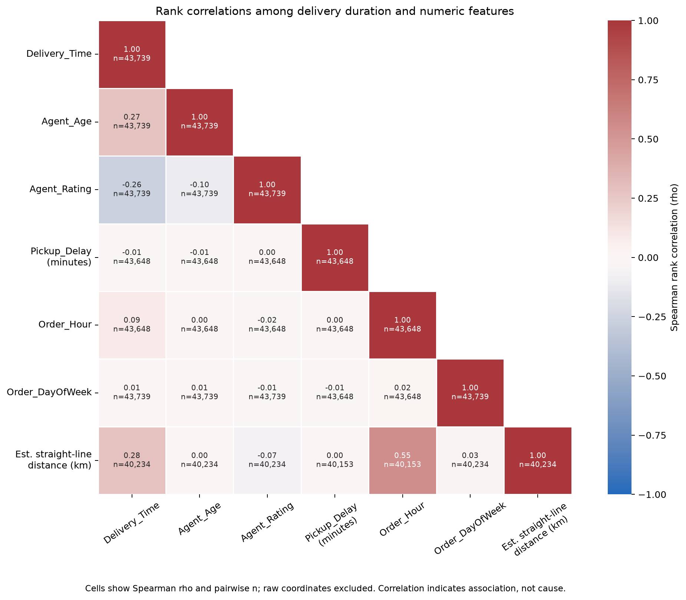
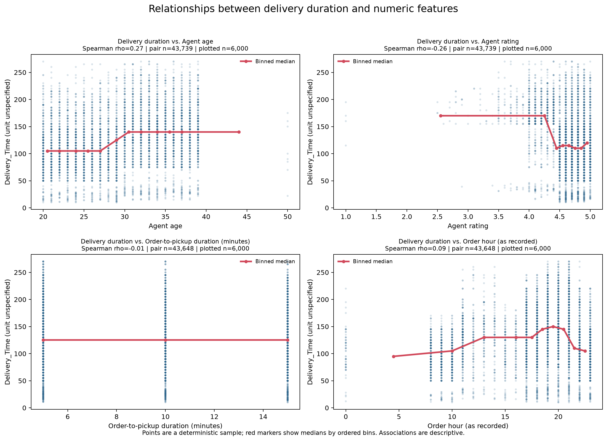
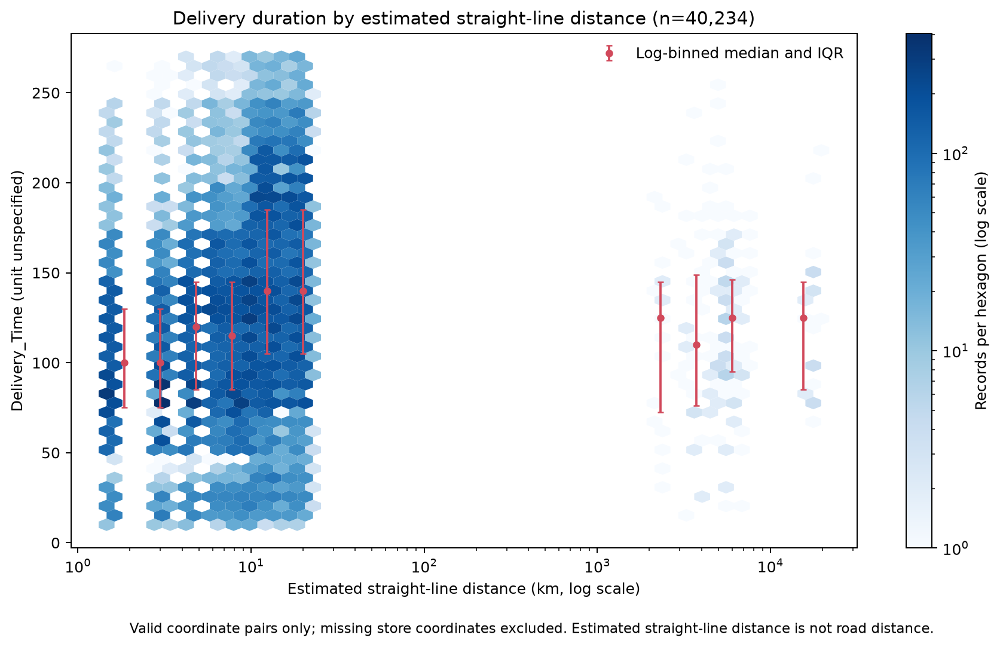

# Numeric relationships with delivery duration

## Dataset and method

This analysis uses the approved `amazon_delivery_cleaned_updated.csv` in the user's Downloads folder. The file contains 43,739 records and 28 columns and remains outside the repository.

`Delivery_Time` is treated as delivery duration; its unit is unspecified because it has not been verified. `Pickup_Delay_Minutes` is the order-to-pickup duration in minutes. The dataset has no promised delivery time, actual delivery timestamp, or delivery status, so this analysis does not calculate on-time, late, completion, or promise-based delay rates.

Spearman rank correlations summarize monotonic relationships between delivery duration and selected numeric features. Pairwise complete sample sizes are reported. Raw latitude and longitude are excluded from correlation because their numeric values do not represent a meaningful linear distance measure. These unadjusted associations are descriptive and do not establish causation.

Estimated straight-line distance is calculated using the great-circle formula from valid store and drop coordinates. Rows with missing store coordinates are excluded, as are rows with missing or invalid drop coordinates. The result is an estimated straight-line distance in kilometers, not road distance or route length.

## Relationship findings

| Numeric feature | Spearman correlation with `Delivery_Time` | Pair records |
| --- | ---: | ---: |
| Estimated straight-line distance (km) | 0.282 | 40,234 |
| `Agent_Age` | 0.274 | 43,739 |
| `Agent_Rating` | -0.259 | 43,739 |
| `Order_Hour` | 0.090 | 43,648 |
| `Pickup_Delay_Minutes` | -0.008 | 43,648 |
| `Order_DayOfWeek` | 0.006 | 43,739 |

The largest observed monotonic associations in this set are with estimated straight-line distance, agent age, and agent rating. The association with order hour is small, while pickup duration and day of week have correlations close to zero. These are unadjusted pairwise relationships; they may reflect overlapping factors and should not be interpreted as effects or causes.

The coordinate calculation excludes 3,505 rows with missing store coordinates. A further set of records without valid drop coordinates is also ineligible, leaving 40,234 distance-and-duration pairs. There are 188 calculated distances above 50 km, with extreme estimates retained because no approved exclusion rule exists. The plot uses a logarithmic distance axis so typical distances remain visible alongside these values.

## Visualizations

*Figure 1. Each cell reports Spearman rank correlation and pairwise sample size. Raw coordinates are excluded; each cell uses pairwise complete records.*

*Figure 2. Each panel plots a deterministic sample of up to 6,000 complete pairs; titles report Spearman correlation, full pair count, and plotted count. Red markers show medians across ordered feature bins. `Delivery_Time` has no unit label because its unit is unverified.*

*Figure 3. Hexbin density and binned median with interquartile range for valid coordinate pairs. Missing store coordinates are excluded; estimated straight-line distance is not road distance.*

## Interpretation and limits

- Correlations describe association in this dataset and do not establish cause and effect.
- Results are unadjusted for other numeric or categorical features.
- Distance is an estimated straight-line measure derived from coordinates; it does not represent a road route. Extreme values are retained and may influence the distance relationship.
- Missing feature values reduce pair counts for order-time, pickup, and distance relationships; no missing values were imputed.
- `Delivery_Time` unit remains unconfirmed. `Pickup_Delay_Minutes` refers to order-to-pickup duration in minutes.
- The data does not support on-time, late, completion, or promise-based delay measures.

Calculations and reproducible plots are in `Notebooks/numeric_relationship_analysis.ipynb`.
